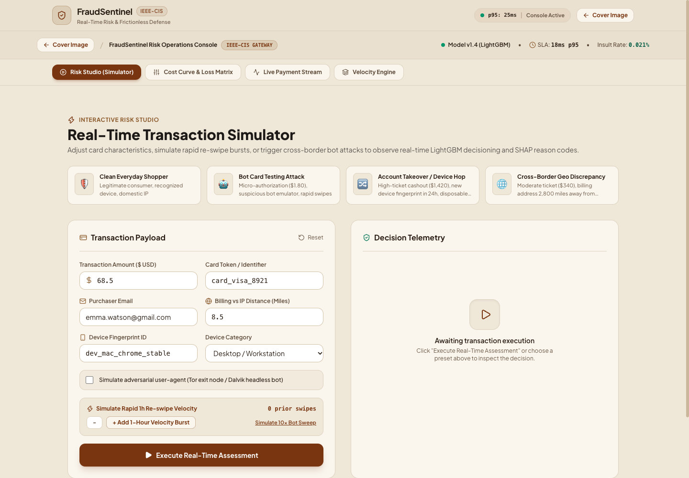
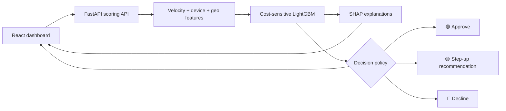

<div align="center">

# 🛡️ FraudSentinel
### Frictionless checkout. Smarter fraud decisions.


A full-stack fraud detection demo that balances payment risk, customer friction, and the cost of getting a decision wrong.

[Preview](#-project-preview) · [Features](#-what-it-does) · [Quick start](#-run-locally) · [API](#-try-the-api)

</div>

---

## 🎨 Project preview

### Landing experience


### Interactive dashboard



The warm cream-and-walnut interface brings transaction simulation, risk explanations, cost curves, and velocity telemetry into one workspace.

## ✨ What it does

| | Capability | How it works |
|---|---|---|
| 🟢 | Approve low-risk payments | Applies the trained policy’s lower risk threshold. |
| 🟡 | Recommend a step-up challenge | Routes intermediate risk into a simulated authentication path. |
| 🔴 | Decline high-risk payments | Blocks scores above the policy’s upper threshold. |
| ⚡ | Track transaction velocity | Maintains per-card rolling counts, spend, and device changes. |
| 🧠 | Explain risk | Uses SHAP contributions to return the strongest risk signals. |
| 💸 | Explore decision costs | Compares fraud losses and false-positive costs across thresholds. |
| 🧪 | Simulate transactions | Lets you explore normal purchases and suspicious scenarios. |

## 🏗️ How it works



The model uses an asymmetric objective to penalize fraud errors more heavily than clean-transaction errors. A cost optimizer selects operating thresholds, while the API returns a risk score, decision, explanation, velocity snapshot, and estimated dollar exposure.

## 🚀 Run locally

**Requirements:** Python 3.13 (used for validation), Node.js 20.19+ or 22.12+, and npm. LightGBM may require the OpenMP runtime on macOS: `brew install libomp`.

From the repository root:

```bash
python3.13 -m venv backend/.venv
source backend/.venv/bin/activate
python -m pip install -r backend/requirements.txt
cd frontend
npm install
cd ..
./run.sh
```

The launcher trains a model if none exists, then starts both services. Keep the virtual environment active when launching.

| Service | Local URL |
|---|---|
| 🎨 Dashboard | http://localhost:5173 |
| 📖 Interactive API docs | http://127.0.0.1:8000/docs |
| 💚 Health | http://127.0.0.1:8000/api/health |

To run the services separately, use two terminals with the Python environment activated:

```bash
# Terminal 1, from the repository root
cd backend
PYTHONPATH=. python -m uvicorn src.api.server:app --host 127.0.0.1 --port 8000
```

```bash
# Terminal 2, from the repository root
cd frontend
npm run dev
```

## 🔌 Try the API

```bash
curl -X POST http://127.0.0.1:8000/api/score \
  -H 'Content-Type: application/json' \
  -d '{"amount":84.50,"card_id":"demo_card_001","device_id":"trusted_browser","email":"shopper@example.com","distance_miles":12,"device_type":"desktop"}'
```

The response includes `risk_score`, `risk_probability`, `decision`, `reasons`, `latency_ms`, and `velocity_snapshot`.

| Method | Endpoint | Purpose |
|---|---|---|
| GET | `/api/health` | Model status and thresholds |
| GET | `/api/metrics` | Evaluation metrics and policy economics |
| GET | `/api/cost-curve` | Threshold-versus-cost data |
| GET | `/api/recent-transactions` | Illustrative transaction feed |
| POST | `/api/score` | Score a transaction |

## 📊 Data and training

The project supports the IEEE-CIS transaction schema. Without local CSVs, it automatically generates synthetic data; no dataset download is needed to explore the demo.

To use your own IEEE-CIS files, place `train_transaction.csv` and optionally `train_identity.csv` in `backend/data/`. The loader splits transactions chronologically into training and evaluation sets.

```bash
cd backend
PYTHONPATH=. python src/models/trainer.py
```

Raw datasets and generated model artifacts are excluded from Git. The first launch recreates the model locally.

## ✅ Validation

Run each block from the repository root, with the Python environment active:

```bash
cd backend
PYTHONPATH=. python -m pytest tests/ -v
```

```bash
cd frontend
npm run build
```

Validated locally: **9 backend tests passed** and the frontend production build completed. Existing dependency deprecation warnings and a frontend bundle-size warning remain.

## 🗂️ Project layout

```text
frictionless-fraud-detection/
├── backend/
│   ├── requirements.txt
│   ├── src/
│   │   ├── api/          # Scoring and telemetry endpoints
│   │   ├── data/         # Dataset loader and synthetic generator
│   │   ├── features/     # Velocity, device, and geography signals
│   │   └── models/       # Training, costs, thresholds, explanations
│   └── tests/
├── frontend/
│   ├── public/          # Visual assets
│   └── src/components/  # Landing page, dashboard, simulator, charts
├── docs/images/         # Project screenshots
└── run.sh               # Start the local stack
```

## 📝 Demo scope

The dashboard includes illustrative metrics and sample transactions. Latency figures are design targets or demo values, rather than independently verified production benchmarks. Synthetic-data results should not be described as measured IEEE-CIS competition performance.

Step-up decisions represent a policy recommendation: this project does not integrate a payment processor, execute 3DS/OTP authentication, or establish an actual liability shift. Velocity state is held in memory and resets when the backend restarts.

---

<div align="center">

🟢 **Less friction** · 🟡 **More context** · 🔴 **Clearer risk decisions**

</div>
